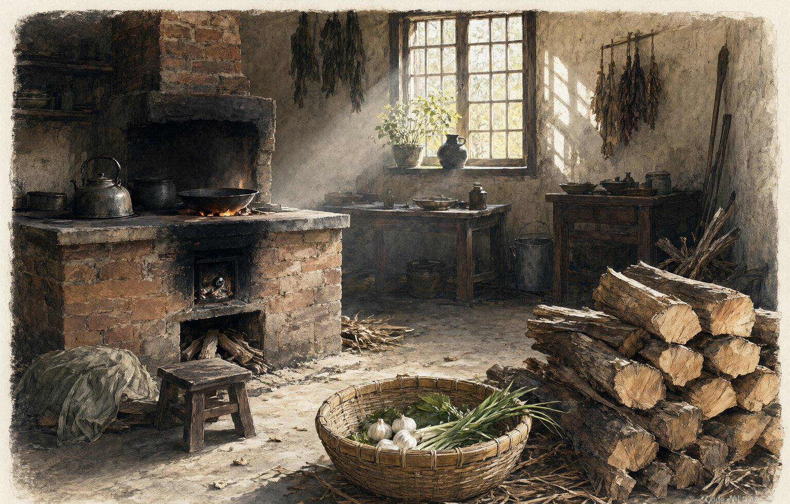

# 《山水有回信》· 写给往后的日子

> 第一本书寄出以后，回信一封一封到了。五十四篇文字，写回信、换季、院子、家里人，以及一段不着急的往后。

*封面 · 林深 著 · 私人印本 · 2027*

| | |
|---|---|
| 作者 | 林深 |
| 类别 | 散文 · 随笔 · 纪实 · 续本 |
| 版本 | 私人印本 · 2027 |
| 规模 | 六卷 · 54 篇 · 约 244,317 字 |
| 字数构成 | 序 2,119 · 正文 240,020 · 后记 2,178 |

## 怎么读

- **在线阅读**：下面目录里每一篇都是 Markdown，点进去就能读，每篇末尾有上一篇 / 下一篇的跳转。
- **离线单文件**：下载 [山水有回信](../../dist/shanshui-youhui.html)，一本完整的书，含封面与六卷插图，双击即可在浏览器里读，也可拷进手机或阅读器。
- **重排整本书**：仓库根目录执行 `python tools/build_shanshui_youhui.py`，见 [tools/README.md](../../tools/README.md)。

## 声明

书中人物多为真实的人，卷五《借来的名字》里的人物均为化名，细节经过文学处理；本书是虚构作品。封面与卷首插图为 AI 生成后裁切调色。完整说明见 [docs/关于名字与插图](../../docs/names-and-images.md)。

这一本是私人印本，没有定价，也没有卖过一本。文本与图片版权保留，请勿成段转载、改编、配音或商用；读、存、把仓库链接发给别人都可以。详见 [LICENSE](../../LICENSE)。

## 目录

**[序：先做一个收信的人](content/front/序-先做一个收信的人.md)** · 2,119 字

### 卷一 · 回信

*一封寄出去的信，要走完它自己的路。* — THE REPLY

*卷一插图 · 摊开的信纸*

1. [书寄出去以后](content/vol1/01-书寄出去以后.md) · 4,265 字
2. [第一封回信](content/vol1/02-第一封回信.md) · 4,212 字
3. [读者的字](content/vol1/03-读者的字.md) · 4,259 字
4. [旧地址](content/vol1/04-旧地址.md) · 4,070 字
5. [电话里的空白](content/vol1/05-电话里的空白.md) · 4,179 字
6. [邮箱里的草稿](content/vol1/06-邮箱里的草稿.md) · 4,071 字
7. [一张明信片](content/vol1/07-一张明信片.md) · 4,258 字
8. [压在书里的信](content/vol1/08-压在书里的信.md) · 4,166 字
9. [回信这件事](content/vol1/09-回信这件事.md) · 4,353 字

本卷 9 篇 · 37,833 字

### 卷二 · 换季

*身体比日历更早知道换季。* — CHANGING SEASONS

*卷二插图 · 换季的清晨*

1. [体检报告上的箭头](content/vol2/01-体检报告上的箭头.md) · 5,094 字
2. [早上的十分钟](content/vol2/02-早上的十分钟.md) · 4,899 字
3. [代码审查](content/vol2/03-代码审查.md) · 4,324 字
4. [一次上线](content/vol2/04-一次上线.md) · 4,365 字
5. [走路去上班](content/vol2/05-走路去上班.md) · 4,342 字
6. [膝盖](content/vol2/06-膝盖.md) · 4,327 字
7. [牙](content/vol2/07-牙.md) · 4,358 字
8. [睡不着的半夜](content/vol2/08-睡不着的半夜.md) · 4,345 字
9. [身体记得](content/vol2/09-身体记得.md) · 4,371 字

本卷 9 篇 · 40,425 字

### 卷三 · 城的里子

*一座城的脸面在街上，里子在巷子里。* — THE CITY INSIDE

*卷三插图 · 院墙与树*

1. [院子要修了](content/vol3/01-院子要修了.md) · 4,331 字
2. [量房子](content/vol3/02-量房子.md) · 4,328 字
3. [树要挪走](content/vol3/03-树要挪走.md) · 4,395 字
4. [搬走的邻居](content/vol3/04-搬走的邻居.md) · 4,696 字
5. [旧货市场](content/vol3/05-旧货市场.md) · 4,336 字
6. [桥下的球场](content/vol3/06-桥下的球场.md) · 4,263 字
7. [一条街的背面](content/vol3/07-一条街的背面.md) · 4,288 字
8. [回到院子里](content/vol3/08-回到院子里.md) · 4,250 字
9. [城里的树](content/vol3/09-城里的树.md) · 4,286 字

本卷 9 篇 · 39,173 字

### 卷四 · 家里的人

*家里人不说想念，只说吃饭。* — THOSE AT HOME

*卷四插图 · 老屋的灶*

1. [母亲的眼镜](content/vol4/01-母亲的眼镜.md) · 4,367 字
2. [表停了](content/vol4/02-表停了.md) · 4,239 字
3. [老屋的灶](content/vol4/03-老屋的灶.md) · 4,180 字
4. [一张全家福](content/vol4/04-一张全家福.md) · 4,546 字
5. [叔叔的果园](content/vol4/05-叔叔的果园.md) · 4,564 字
6. [回门](content/vol4/06-回门.md) · 4,517 字
7. [清明](content/vol4/07-清明.md) · 4,489 字
8. [送父亲回家](content/vol4/08-送父亲回家.md) · 4,459 字
9. [家里的灯](content/vol4/09-家里的灯.md) · 4,353 字

本卷 9 篇 · 39,714 字

### 卷五 · 借来的名字

*他们把名字借给我，我把日子还给他们。* — BORROWED NAMES

*卷五插图 · 街边的小铺*

1. [老金的伞铺](content/vol5/01-老金的伞铺.md) · 5,398 字
2. [缝纫机的下午](content/vol5/02-缝纫机的下午.md) · 5,082 字
3. [送奶的人](content/vol5/03-送奶的人.md) · 4,637 字
4. [夜班公交](content/vol5/04-夜班公交.md) · 4,652 字
5. [收摊以后](content/vol5/05-收摊以后.md) · 4,475 字
6. [修表铺](content/vol5/06-修表铺.md) · 4,414 字
7. [打印店](content/vol5/07-打印店.md) · 4,497 字
8. [收废品的人](content/vol5/08-收废品的人.md) · 4,267 字
9. [他们把名字借给我](content/vol5/09-他们把名字借给我.md) · 4,222 字

本卷 9 篇 · 41,644 字

### 卷六 · 往后的日子

*往后不是远方，是明天早上。* — THE DAYS AHEAD

*卷六插图 · 河边的冬日*

1. [湖州来的信](content/vol6/01-湖州来的信.md) · 4,759 字
2. [第一次见面](content/vol6/02-第一次见面.md) · 4,621 字
3. [两碗面](content/vol6/03-两碗面.md) · 4,643 字
4. [她的母亲](content/vol6/04-她的母亲.md) · 4,766 字
5. [不着急](content/vol6/05-不着急.md) · 4,626 字
6. [第二本书](content/vol6/06-第二本书.md) · 4,428 字
7. [写给四十五岁](content/vol6/07-写给四十五岁.md) · 4,449 字
8. [冬至](content/vol6/08-冬至.md) · 4,389 字
9. [山水有回信](content/vol6/09-山水有回信.md) · 4,550 字

本卷 9 篇 · 41,231 字

**[后记：灯还亮着](content/back/后记-灯还亮着.md)** · 2,178 字

