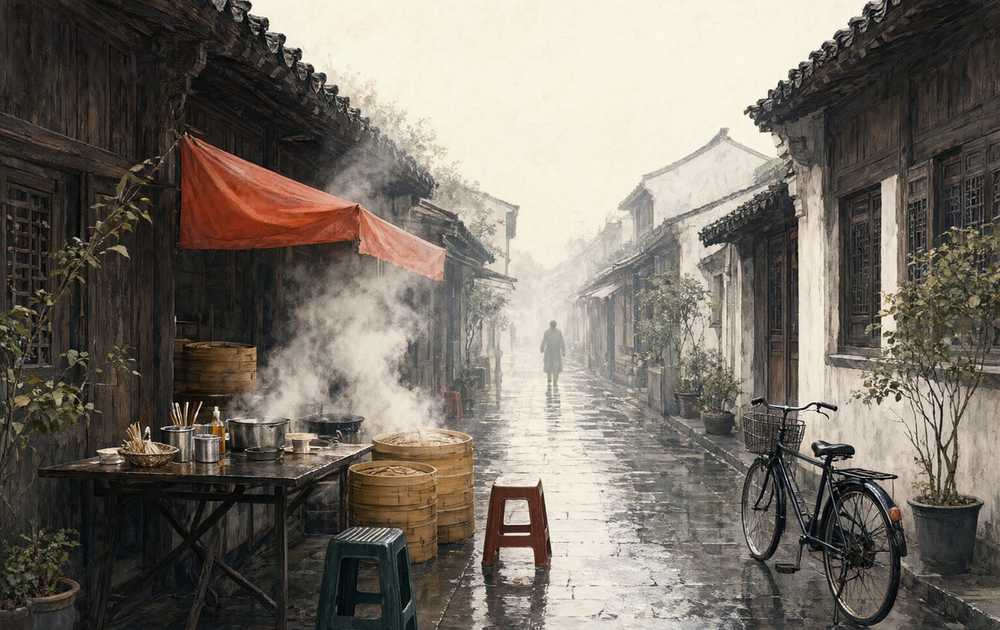

# 《山水有信》· 写给日常的长信

> 四十八篇文字，写一座城、一张书桌、几段山路，以及那些在时间里慢慢发光的人。

*封面 · 林深 著 · 私人印本 · 2026*

| | |
|---|---|
| 作者 | 林深 |
| 类别 | 散文 · 随笔 · 纪实 |
| 版本 | 私人印本 · 2026 |
| 规模 | 六卷 · 48 篇 · 约 208,045 字 |
| 字数构成 | 序 3,196 · 正文 202,943 · 后记 1,906 |

## 怎么读

- **在线阅读**：下面目录里每一篇都是 Markdown，点进去就能读，每篇末尾有上一篇 / 下一篇的跳转。
- **离线单文件**：下载 [山水有信](../../dist/shanshui-youxin.html)，一本完整的书，含封面与六卷插图，双击即可在浏览器里读，也可拷进手机或阅读器。
- **重排整本书**：仓库根目录执行 `python tools/build_shanshui_youxin.py`，见 [tools/README.md](../../tools/README.md)。

## 声明

书中人物多为真实的人，卷五《人间烟火》里的人物均为化名，细节经过文学处理；本书是虚构作品。封面与卷首插图为 AI 生成后裁切调色。完整说明见 [docs/关于名字与插图](../../docs/names-and-images.md)。

这一本是私人印本，没有定价，也没有卖过一本。文本与图片版权保留，请勿成段转载、改编、配音或商用；读、存、把仓库链接发给别人都可以。详见 [LICENSE](../../LICENSE)。

## 目录

**[序：写给还没有名字的明天](content/front/序-写给还没有名字的明天.md)** · 3,196 字

### 卷一 · 慢下来的日子

*日子不是用来赶的，是用来过的。* — THE ART OF SLOWING DOWN

*卷一插图 · 窗边的清晨*

1. [把生活写成一封长信](content/vol1/01-把生活写成一封长信.md) · 4,235 字　— 周日清晨不设闹钟。煮咖啡、洗床单、给远方的朋友写信，在琐事里重新发现日子的纹理。
2. [早晨的第三个闹钟](content/vol1/02-早晨的第三个闹钟.md) · 4,205 字　— 从依赖三个闹钟到只留一个。写醒来的十分钟、窗外的光和一杯水的温度，以及身体重新学会的节律。
3. [一碗面的时间](content/vol1/03-一碗面的时间.md) · 4,198 字　— 照父亲的方法煮一碗雪菜肉丝面。等待水开、切葱、洗碗，在一碗面里理解耐心与照料。
4. [桂花落下的声音](content/vol1/04-桂花落下的声音.md) · 4,211 字　— 满觉陇和小区院子里同时开了桂花。写香气如何穿过城市，也写一位捡桂花做糖桂花的老人。
5. [整理房间，也整理心](content/vol1/05-整理房间-也整理心.md) · 4,218 字　— 整理出租屋，翻出旧信、坏掉的耳机和一箱书。判断什么该留下，也是在判断自己想过怎样的生活。
6. [雨天的阳台](content/vol1/06-雨天的阳台.md) · 4,202 字　— 梅雨季的周末，阳台上的衣服总也晾不干。听雨、收衣服、和隔壁阳台的猫对视，时间变得很慢。
7. [城市里的散步者](content/vol1/07-城市里的散步者.md) · 4,199 字　— 沿运河夜行，不戴耳机。记录桥洞下的萨克斯、夜钓的人、跑步者和便利店，写一个不抵达的散步。
8. [慢不是停下来](content/vol1/08-慢不是停下来.md) · 4,246 字　— 计划被取消后，得到一整天空白。先焦虑，后做饭、发呆、看云，最后承认休息不需要理由。

本卷 8 篇 · 33,714 字

### 卷二 · 代码与咖啡

*好的工具像一张称手的书桌：不喧哗，也不缺席。* — BETWEEN CODE AND COFFEE

*卷二插图 · 深夜的书桌*

1. [在代码与咖啡之间](content/vol2/01-在代码与咖啡之间.md) · 4,255 字　— 周六早晨磨豆、注水，等一杯咖啡。与此同时写一个小工具，写代码和咖啡如何共享同一段专注。
2. [一间数字书房](content/vol2/02-一间数字书房.md) · 4,203 字　— 用 Streamlit 搭建个人博客，给互联网留一间不上锁的书房。写命名、删改、配色和深夜上线的过程。
3. [把复杂留给系统，把简单留给用户](content/vol2/03-把复杂留给系统-把简单留给用户.md) · 4,213 字　— 为产品重做一页设置。跟三位用户聊天，删掉一半选项，理解“简单”不是少做，而是替人承担复杂。
4. [删除的艺术](content/vol2/04-删除的艺术.md) · 4,089 字　— 清理一个十年的老项目，删掉上万行代码。写删除的恐惧、权限、依赖，以及为旧功能办一场体面的告别。
5. [凌晨两点的构建](content/vol2/05-凌晨两点的构建.md) · 4,228 字　— 一次凌晨的发布事故。服务器、日志、同事的语音，以及天亮后对“救火英雄”叙事的反思。
6. [工具的温度](content/vol2/06-工具的温度.md) · 4,148 字　— 一把用了八年的键盘、一台旧笔记本和几件顺手的工具。写器物如何记住人的习惯。
7. [与 bug 相处的下午](content/vol2/07-与bug相处的下午.md) · 4,108 字　— 一个只在闰年出现的日期 bug。查日志、复现、修复，写程序员的谦卑和与自己较劲的下午。
8. [产品经理的散步](content/vol2/08-产品经理的散步.md) · 4,125 字　— 和老周绕着园区散步，观察早餐摊前的人流。产品灵感不在会议室，而在别人真实的动作里。

本卷 8 篇 · 33,369 字

### 卷三 · 书桌与远方

*身体到不了的地方，书先替我们抵达。* — BOOKS AND DISTANCE

*卷三插图 · 雨中的书页*

1. [一个人的周末书单](content/vol3/01-一个人的周末书单.md) · 4,361 字　— 一个没有安排的周末，三本书、一壶茶。写阅读的节奏，也写孤独如何变成一种丰盛。
2. [书页里的雨天](content/vol3/02-书页里的雨天.md) · 4,220 字　— 雨天走进一间旧书店，买到一本有陌生人批注的书。沿着铅笔线，猜另一个读者的生活。
3. [重读的意义](content/vol3/03-重读的意义.md) · 4,233 字　— 重读十年前读过的书，发现划线的地方变了。写书没有变，变的是读书的人。
4. [山茶文具店与未寄出的信](content/vol3/04-山茶文具店与未寄出的信.md) · 4,239 字　— 整理抽屉里的信纸和邮票，给一位久未联系的朋友写信，最终没有寄出。写未完成的心意。
5. [设计中的留白](content/vol3/05-设计中的留白.md) · 4,244 字　— 从一张宋画和一间咖啡馆的招牌，谈留白。生活也需要不被填满的地方。
6. [在图书馆坐一下午](content/vol3/06-在图书馆坐一下午.md) · 4,167 字　— 在市民图书馆坐一下午，查旧报纸、看陌生人。写公共空间里那种互不打扰的陪伴。
7. [写作的羞耻感](content/vol3/07-写作的羞耻感.md) · 4,254 字　— 写下第一篇文章时的羞耻感，害怕被熟人看见。写修改、发布、匿名与被理解的渴望。
8. [给未来的自己留一本书](content/vol3/08-给未来的自己留一本书.md) · 4,272 字　— 在扉页写下日期，把一本书留给十年后的自己。写对未来的想象，也写此刻想记住的事。

本卷 8 篇 · 33,990 字

### 卷四 · 山野有信

*山不向我走来，我便向山走去。* — LETTERS FROM THE WILD

*卷四插图 · 雾中的山脊*

1. [去山里过了一个没有信号的周末](content/vol4/01-去山里过了一个没有信号的周末.md) · 4,246 字　— 临安山里没有信号的周末。徒步、民宿、桂花树和满天星，写断开连接后的听觉。
2. [临安的桂花](content/vol4/02-临安的桂花.md) · 4,197 字　— 秋天再去临安，寻访一户种桂花的人家。写收桂花、晒桂花和村庄的时间。
3. [沿着溪水走](content/vol4/03-沿着溪水走.md) · 4,189 字　— 沿九溪走到龙井村，跟着水声上山。写水、石头的形状，也写童年家乡的那条河。
4. [山顶的云](content/vol4/04-山顶的云.md) · 4,215 字　— 登太子尖遇雾，最终决定下撤。写山顶的云、错误的坚持，以及知道何时回头。
5. [一个人坐火车](content/vol4/05-一个人坐火车.md) · 4,272 字　— 一个人坐慢车去景德镇。看窗外、吃盒饭、听陌生人讲他的瓷厂。写铁路上的时间。
6. [海边的风](content/vol4/06-海边的风.md) · 4,338 字　— 去东极岛看海，同行的是即将离开杭州的朋友。写风、浪、失眠和一封没有说出口的告别。
7. [村庄的早晨](content/vol4/07-村庄的早晨.md) · 4,280 字　— 回常山老家，赶一次早市。写祖母的村子、豆浆摊、鸡鸣和离开前的早饭。
8. [回来的路](content/vol4/08-回来的路.md) · 4,194 字　— 旅行结束回到杭州，拖着行李箱走过熟悉的街道。写归来后的陌生感，以及真正带回来的东西。

本卷 8 篇 · 33,931 字

### 卷五 · 人间烟火

*每一个普通人的一天，都值得被认真看见。* — THE HUMAN STREET

*卷五插图 · 清晨的街巷*

1. [楼下的早餐店](content/vol5/01-楼下的早餐店.md) · 4,306 字　— 凌晨四点的早餐店。老陈和阿琴做豆浆、煎饺，供女儿读大学。写一只炉子撑起的一家人。
2. [修伞的人](content/vol5/02-修伞的人.md) · 4,287 字　— 高架桥下修伞的老金。伞骨、尼龙线、二十年的摊子，写被丢弃之物和一个人的手艺。
3. [夜班的出租车司机](content/vol5/03-夜班的出租车司机.md) · 4,259 字　— 夜班出租车司机老吴。凌晨的医院、火车站和便利店，写一座城市的后半夜。
4. [菜市场里的时间](content/vol5/04-菜市场里的时间.md) · 4,316 字　— 菜市场卖菜的王姐。从春笋到冬腌菜，写摊位上的四季和熟客之间的默契。
5. [房东阿姨的桂花树](content/vol5/05-房东阿姨的桂花树.md) · 4,245 字　— 房东陈阿姨和院子里的桂花树。老房子可能拆迁，写树、租金与人情。
6. [搬家那天](content/vol5/06-搬家那天.md) · 4,500 字　— 搬家师傅小赵的一天。旧家具、电梯、纸箱和客户的故事，写搬运别人生活的人。
7. [地铁末班车](content/vol5/07-地铁末班车.md) · 4,219 字　— 地铁末班车上的清洁工刘阿姨、加班的人和醉汉。写城市收尾时的安静。
8. [快递站的小哥](content/vol5/08-快递站的小哥.md) · 4,456 字　— 快递站的小杨。双十一、货架、老家的孩子，写包裹背后流动的生活。

本卷 8 篇 · 34,588 字

### 卷六 · 与时间相处

*时间不回答，只留下纹理。* — WITH TIME

*卷六插图 · 旧桌上的光*

1. [父亲的手表](content/vol6/01-父亲的手表.md) · 4,244 字　— 父亲寄来一块停走的旧手表。去修表摊，听父亲讲年轻时买表的事，写时间与衰老。
2. [母亲的菜谱](content/vol6/02-母亲的菜谱.md) · 4,023 字　— 母亲的蓝色笔记本，记着十几道菜的做法。照着做一道红烧肉，写味道里的记忆。
3. [旧照片](content/vol6/03-旧照片.md) · 4,145 字　— 整理旧相册，扫描祖父母的照片。写照片褪色、人物离场，以及记忆的不可靠。
4. [三十岁以后](content/vol6/04-三十岁以后.md) · 4,121 字　— 三十五岁以后，身体、朋友和工作都变了。写不再逞强，也写新的自由。
5. [关于告别](content/vol6/05-关于告别.md) · 4,474 字　— 送别一位离开杭州的朋友。最后一顿饭、空房间、站台，写告别的练习。
6. [生日那天](content/vol6/06-生日那天.md) · 4,028 字　— 生日当天没有聚会。接到父母电话，给自己煮面，写年龄增长后的安静。
7. [时间留下的纹理](content/vol6/07-时间留下的纹理.md) · 4,197 字　— 一张用了十年的木桌、磨损的键盘和父亲的手。写物件上的时间纹理。
8. [一封没有寄出的信](content/vol6/08-一封没有寄出的信.md) · 4,119 字　— 给二十岁的自己写一封信，没有寄出。写后悔、原谅和仍在继续的路。

本卷 8 篇 · 33,351 字

**[后记：把灯留着](content/back/后记-把灯留着.md)** · 1,906 字

